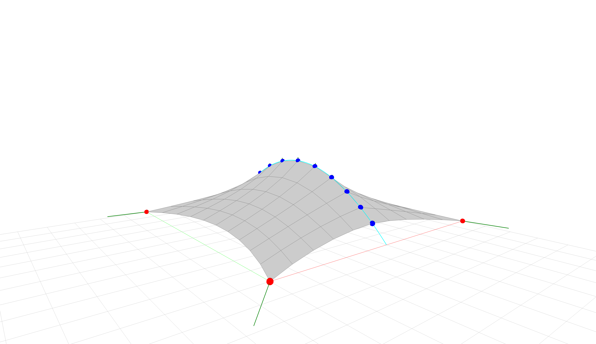

# Worked examples

## Loaded network

This example follows the linear equilibrium equations in
[Schek (1974)](https://doi.org/10.1016/0045-7825(74)90045-0). The anchors sit at
`(0, 0, 0)` and `(4, 0, 0)`, with force densities 1 and 3. A downward load
of 4 puts the free vertex at `(3, 0, -1)`.

```python
--8<-- "docs/examples/loaded_network.py"
```

## Mesh supported by an arch

The original example fixes the corner vertices of a mesh and lets a row of
supports slide along a NURBS arch. Each support moves according to the
tangential component of its residual force. The [example script](examples/example_mesh_constrained_on-arch.py)
requires a viewer and a NURBS backend.



The [mesh grid script](examples/example_mesh_basic.py) shows how to visualize
a direct force-density solve with COMPAS Viewer. Both viewer scripts are
retained as COMPAS 2 examples. The loaded-network example is exercised in
COMPAS 3 CI.
